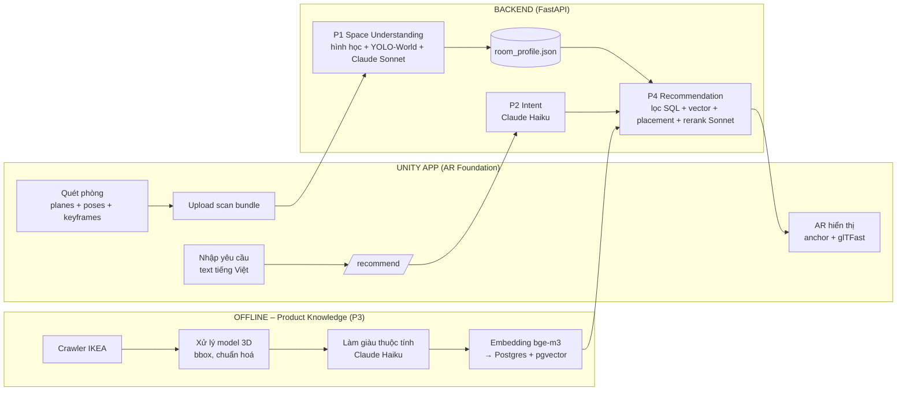

# PLAN – App AR gợi ý & đặt nội thất IKEA vào căn phòng

> Mục tiêu: người dùng quét căn phòng bằng camera và nói/nhập yêu cầu → app gợi ý sản phẩm IKEA phù hợp → chỉ ra nên đặt ở đâu → bật camera, lia đến đâu mô hình 3D hiện ra đúng chỗ, đúng kích thước thật.

## 0. Các quyết định đã chốt

| Hạng mục | Lựa chọn | Lý do |
|---|---|---|
| Nền tảng app | **Unity 6 + AR Foundation** (ARCore cho Android, ARKit cho iOS) | Một codebase chạy cả iOS lẫn Android. Load được file `.glb` nén Draco của IKEA qua glTFast. AR Foundation đã có sẵn plane detection, anchor, light estimation và occlusion. |
| Cách lấy "video" căn phòng | **Quay ngay trong phiên AR của app** | Mỗi frame có sẵn tư thế camera, mặt sàn và mặt tường **theo mét thật**. Bước quét và bước đặt đồ dùng **chung một hệ toạ độ**, nên không phải giải bài toán định vị lại (relocalization), là phần khó và dễ sai nhất. |
| LLM / Vision | **Claude API**: `claude-sonnet-5-5` (hiểu ảnh phòng, xếp hạng + giải thích), `claude-haiku-4-5-20251001` (trích xuất ý định, làm giàu catalog) | Sonnet làm phần cần suy luận và đọc ảnh. Haiku làm việc lặp nhiều lần với chi phí và độ trễ thấp. |
| Quy mô | Demo / đồ án, **~10–12 tuần**, catalog **300–500 sản phẩm có 3D** | Ưu tiên chạy được end-to-end trước, sau đó mới làm sâu từng module. |
| Backend | Python 3.11 + FastAPI, PostgreSQL + pgvector (Docker) | Cả pipeline AI và crawler đều viết bằng Python. pgvector cho phép **lọc SQL cứng** (giá, kích thước) và **tìm kiếm vector** trong cùng một truy vấn. |
| Embedding | `BAAI/bge-m3` (chạy local) | Đa ngôn ngữ, hiểu tốt tiếng Việt, miễn phí, vector 1024 chiều. |

**Nguyên tắc thiết kế xuyên suốt:**
- **LLM lo phần ngữ nghĩa, thuật toán lo phần hình học.** LLM giỏi hiểu phong cách, ý định và giải thích lý do, nhưng hay tính sai toạ độ và kích thước. Vì vậy mọi con số về vị trí, kích thước và độ vừa vặn đều do code hình học tính. LLM chỉ được **chọn trong danh sách đã kiểm chứng** (product_id, zone_id), không được tự nghĩ ra.

---

## 1. Kiến trúc tổng thể



**Luồng người dùng (end-to-end):**
1. Mở app → phiên AR bắt đầu → người dùng lia camera quanh phòng trong 20–60 giây. App hiển thị lưới sàn và tường đã nhận diện để người dùng biết đã quét đủ chưa.
2. App gửi gói dữ liệu quét (scan bundle) lên server → server trả về `room_profile`.
3. Người dùng nhập yêu cầu, ví dụ *"Tôi muốn thêm một ghế đọc sách và đèn cây, phong cách tối giản, dưới 30 nghìn yên"*.
4. Server trả về 3–5 gợi ý, mỗi gợi ý kèm lý do và **vị trí đặt** (toạ độ + góc xoay trong hệ toạ độ của phiên AR).
5. App hiển thị vùng gợi ý trên sàn và tải các mô hình `.glb`. Mô hình được gắn anchor tại vị trí đó, nên camera lia đến đâu thì mô hình hiện ra đúng chỗ đó. Người dùng có thể kéo, xoay, đổi sang sản phẩm thay thế hoặc xem giá.

> ⚠️ Ràng buộc quan trọng: **không reset phiên AR giữa bước quét và bước hiển thị.** Nếu app vào background và mất tracking thì phải quét lại. Phần lưu và khôi phục phòng thuộc giai đoạn sau, xem mục 9.

---

## 2. Giai đoạn 3 – Product Knowledge (làm trước, offline)

> Làm giai đoạn này trước vì mọi giai đoạn khác đều cần catalog. Hơn nữa đây là phần ít rủi ro nhất và đã làm được một phần.

### 3.1 Crawl dữ liệu ✅ (đã có, cần mở rộng)
- **Input:** sitemap `https://www.ikea.com/sitemaps/prod-en-JP_{1..4}.xml`, kèm URL seed nếu có.
- **Công cụ:** `crawler/ikea_crawler.py` (requests). Link 3D lấy từ JSON-LD `3DModel`, metadata lấy từ `<script type="text/hydrate">`.
- **Output:** `data/models/<item>.glb`, `data/images/<item>.jpg`, `data/products/<item>.json`, `data/catalog.jsonl`
- **Việc cần làm thêm:**
  - Lọc theo `category_path` (Sofas, Armchairs, Chairs, Tables, Desks, Beds, Storage, Bookcases, TV benches, Lamps, Rugs…) thay vì lọc theo từ khoá trong slug. Cách cũ từng chọn nhầm sản phẩm "cabinet lighting".
  - Crawl **300–500 sản phẩm có 3D**, chia quota theo danh mục để danh mục nào cũng đủ đa dạng.
  - Khoảng 45% sản phẩm không có 3D, nên chỉ giữ những sản phẩm có model.
- **Lưu ý:** IKEA không có site Việt Nam nên giá đang là JPY. Khi hiển thị sẽ quy đổi sang VND theo một tỉ giá cố định trong config.

### 3.2 Xử lý mô hình 3D
- **Input:** `data/models/*.glb` (nén Draco) cùng với `dimensions_cm` từ metadata.
- **Công cụ:** `gltf-transform` CLI (Node) để giải nén và inspect, `trimesh` (Python) để tính bounding box.
- **Các bước:**
  1. Tính bounding box theo mét, so sánh với `dimensions_cm` và **gắn cờ nếu lệch quá 10%**. Lý do: AR phải hiển thị đúng kích thước thật, nếu model sai tỉ lệ thì toàn bộ trải nghiệm sai theo.
  2. Kiểm tra gốc toạ độ có nằm ở đáy-giữa không và mặt trước có quay về hướng +Z không. Nếu không thì ghi lại offset hoặc phép xoay để app tự bù.
  3. Giữ nguyên nén Draco vì glTFast đọc được và file nhẹ. Đếm số tam giác để cảnh báo model quá nặng cho điện thoại.
- **Output:** bảng `model_meta`: `{item_no, bbox_m:[w,h,d], origin_ok, front_axis, tri_count, scale_ok}`

### 3.3 Làm giàu thuộc tính (enrichment)
- **Input:** text của sản phẩm (tên, loại, mô tả, vật liệu, danh mục) cùng ảnh chính.
- **Công cụ:** Claude Haiku 4.5 với output JSON theo schema (Pydantic validate, sai thì retry).
- **Output** (thêm vào từng sản phẩm):
  ```json
  {
    "category_norm": "armchair",
    "placement_type": "floor",          // floor | wall | tabletop | ceiling
    "against_wall": false,
    "front_clearance_cm": 60,
    "room_types": ["living_room", "bedroom"],
    "styles": ["scandinavian", "minimalist"],
    "colors": ["beige", "light_wood"],
    "tags": ["reading", "compact"]
  }
  ```
- **Tại sao cần bước này:** dữ liệu IKEA không có sẵn các trường như *đặt sát tường hay không*, *đặt trên sàn hay trên bàn*, *phong cách*. Thiếu những trường này thì giai đoạn 4 không lọc được và không biết đặt sản phẩm ở đâu. Chạy một lần cho khoảng 500 sản phẩm nên chi phí thấp.

### 3.4 Indexing
- **Input:** metadata, `model_meta` và kết quả enrichment.
- **Công cụ:** `sentence-transformers` + `BAAI/bge-m3`, PostgreSQL 16 + pgvector (docker-compose).
- **Văn bản dùng để embed:** `name + type_name + summary + materials + styles + colors + room_types + kích thước`.
- **Output:** bảng `products` (các cột có cấu trúc: price, w/d/h, category_norm, placement_type…) và cột `embedding vector(1024)`. File `.glb` được serve tĩnh qua `/static/models/`.
- **Tại sao dùng pgvector thay vì vector DB riêng:** một câu SQL vừa lọc cứng (`price <= budget AND width_cm <= free_w`) vừa sắp xếp theo độ tương đồng. Với 500 sản phẩm, pgvector dư sức.

---

## 3. Giai đoạn 1 – Space Understanding (hiểu căn phòng)

### 1.1 Quét trong app (Unity)
- **Input:** camera của điện thoại trong phiên AR.
- **Công cụ:** `ARPlaneManager` (sàn ngang, tường dọc), `ARCameraManager.TryAcquireLatestCpuImage` để lấy keyframe, `XRCameraIntrinsics`, và `AROcclusionManager` để lấy depth nếu máy hỗ trợ (ARCore Depth API hoặc LiDAR).
- **Chọn keyframe ngay trên máy:** lấy một frame mỗi khi camera di chuyển ≥ 0.5 m hoặc xoay ≥ 20°, bỏ frame bị mờ. Mục tiêu khoảng 15–30 ảnh JPEG cạnh 1280px. Lý do: không gửi cả video lên server vì quá nặng và dư thừa. Keyframe đi kèm pose thì giá trị hơn nhiều so với video thô.
- **Output – `scan bundle`** (multipart upload):
  ```json
  {
    "scan_id": "uuid",
    "coord": "unity_world_meters_y_up",
    "planes": [{"id": "p1", "alignment": "horizontal_up", "center": [..], "normal": [..], "boundary": [[x,z], ...]},
               {"id": "p7", "alignment": "vertical", ...}],
    "keyframes": [{"file": "kf_000.jpg", "pose": [[4x4]], "intrinsics": {"fx":..,"fy":..,"cx":..,"cy":..}, "w":1280, "h":720}],
    "light": {"ambient_intensity": 0.8}
  }
  ```

### 1.2 Hình học phòng (server, xử lý tất định)
- **Công cụ:** `numpy`, `shapely`, `open3d` (tuỳ chọn).
- **Các bước:**
  1. **Sàn:** chọn mặt phẳng ngang lớn nhất và thấp nhất, gộp các boundary bằng `shapely.union` để ra đa giác sàn, rồi tính diện tích.
  2. **Tường:** chiếu các mặt phẳng dọc xuống mặt sàn để được các đoạn thẳng, sau đó snap về các hướng vuông góc nhau (giả định Manhattan, đúng với đa số phòng).
  3. Ước lượng kích thước phòng (dài × rộng) và chiều cao trần nếu nhận được trần.
- **Tại sao không dùng mô hình dựng 3D từ video (VGGT, COLMAP…):** ARCore/ARKit đã cho sẵn pose và mặt phẳng theo mét thật. Dựng lại 3D chỉ thêm độ trễ và gây sai tỉ lệ.

### 1.3 Nhận diện đồ vật đang có trong phòng
- **Công cụ:** **YOLO-World** (ultralytics, open-vocabulary) với prompt `sofa, bed, table, chair, desk, wardrobe, tv, door, window, shelf, plant, lamp…`.
- **Các bước:**
  1. Chạy detector trên từng keyframe để lấy box 2D.
  2. **Nâng box lên 3D:** bắn tia từ tâm camera qua điểm giữa cạnh đáy của box, giao với mặt sàn để ra vị trí trên sàn. Bề rộng box ở độ sâu đó cho ra bề rộng của vật. Nếu có depth map thì lấy trung vị depth trong box để chính xác hơn.
  3. Gộp các detection của cùng một vật ở nhiều frame bằng cách nhóm theo khoảng cách 3D (NMS 3D).
- **Tại sao không giao việc này cho Claude:** Claude hiểu ảnh tốt nhưng toạ độ box không chính xác, và gọi Claude cho mỗi frame thì tốn. YOLO-World chạy nhanh, cho box chính xác hơn và không mất phí.

### 1.4 Hiểu ngữ nghĩa phòng
- **Input:** 6–8 keyframe đại diện cùng bản tóm tắt hình học (kích thước, danh sách đồ vật đã nhận diện).
- **Công cụ:** Claude Sonnet 5.5 (vision), output JSON theo schema.
- **Output:** `room_type`, `style`, `dominant_colors`, `floor_material`, `lighting` (nắng hay tối), `existing_furniture` (để đối chiếu và sửa kết quả YOLO), `observations` (ví dụ "góc cạnh cửa sổ còn trống, nhiều ánh sáng").

### 1.5 Bản đồ không gian trống
- **Công cụ:** lưới chiếm chỗ (occupancy grid) 2D, ô 5 cm, phủ lên đa giác sàn (`numpy`, `scipy.ndimage.distance_transform_edt`).
- Đánh dấu các ô bị đồ vật chiếm (cộng thêm biên an toàn), vùng mở cửa (giữ trống 80 cm), và khoảng cách tới tường.
- **Output cuối của giai đoạn 1 – `room_profile.json`:**
  ```json
  {
    "scan_id": "...", "floor_y": -1.32, "area_m2": 14.2, "size_m": [4.1, 3.5],
    "floor_polygon": [[x,z], ...],
    "walls": [{"id": "w1", "p0": [x,z], "p1": [x,z], "normal": [nx,nz]}],
    "openings": [{"type": "door", "wall": "w2", "center": [x,z], "width": 0.85}],
    "objects": [{"label": "sofa", "center": [x,z], "size": [2.0, 0.9], "yaw": 90}],
    "free_grid": {"res": 0.05, "origin": [x,z], "file": "grid.npy"},
    "semantics": {"room_type": "living_room", "style": "modern", "dominant_colors": ["white","grey"], "...": "..."}
  }
  ```
- **Debug:** vẽ top-down (matplotlib) gồm sàn, tường, đồ vật và vùng trống ra file PNG. Bắt buộc phải có, vì thiếu nó thì rất khó biết lỗi nằm ở bước nào.

---

## 4. Giai đoạn 2 – User Intent Understanding

- **Input:** câu yêu cầu của người dùng (tiếng Việt hoặc tiếng Anh) cùng `room_profile.semantics` để có ngữ cảnh. Nhập giọng nói là tính năng mở rộng (speech-to-text trên máy).
- **Công cụ:** Claude Haiku 4.5 với JSON schema cố định (Pydantic).
- **Output – `intent.json`:**
  ```json
  {
    "items": [{"category": "armchair", "qty": 1, "purpose": "reading"},
              {"category": "floor_lamp", "qty": 1}],
    "budget": {"max": 30000, "currency": "JPY", "scope": "total"},
    "styles": ["minimalist"], "colors": [], "avoid": [],
    "constraints": ["small_space"],
    "search_queries": {"armchair": "comfortable minimalist reading armchair, compact", "floor_lamp": "..."},
    "clarification_needed": null
  }
  ```
- **Logic:**
  - Thiếu thông tin quan trọng (ví dụ "muốn đồ đẹp" mà không nói là món gì) thì trả về **một câu hỏi lại**, tối đa một lượt, rồi gợi ý dựa trên phân tích phòng (ví dụ phòng khách chưa có đèn nên gợi ý đèn).
  - Quy đổi tiền: người dùng nói "1 triệu" thì đổi sang JPY theo tỉ giá trong config.
- **Tại sao phải tách bước này ra:** ngân sách, số lượng và danh mục phải được **lọc chính xác**. Nếu chỉ dùng embedding thì một chiếc sofa 80.000 yên vẫn có thể lọt vào kết quả "dưới 30.000 yên". `search_queries` được viết lại bằng tiếng Anh cho khớp với ngôn ngữ của catalog, giúp embedding tìm tốt hơn.

---

## 5. Giai đoạn 4 – Recommendation Engine

- **Input:** `intent.json`, `room_profile.json`, DB `products`.
- **Output – `recommendations.json`:**
  ```json
  {
    "items": [{
      "product_id": "60417637", "name": "YNGVAR Chair", "price": 9990, "price_vnd": 1650000,
      "glb_url": "/static/models/60417637.glb", "image_url": "...", "ikea_url": "...",
      "reason_vi": "Ghế gọn, tông gỗ sáng hợp với sàn hiện tại; đặt cạnh cửa sổ để đọc sách.",
      "placement": {"zone_id": "z3", "position": [1.2, -1.32, 0.4], "yaw_deg": 135, "footprint_m": [0.53, 0.51]},
      "alternatives": ["...", "..."]
    }],
    "total_price": 24980
  }
  ```

### 4.1 Lấy ứng viên (lọc cứng + tìm kiếm ngữ nghĩa)
- Mỗi món trong `intent.items` chạy một truy vấn:
  `WHERE category_norm = ? AND price <= ? AND w_cm,d_cm vừa với hình chữ nhật trống lớn nhất ORDER BY embedding <=> query_vec LIMIT 30`
- **Tại sao:** lọc cứng đảm bảo không vi phạm ngân sách hay kích thước, còn vector đảm bảo hợp với ý người dùng.

### 4.2 Tìm vị trí đặt (thuật toán hình học, tất định)
- Mỗi ứng viên được thử vị trí trên lưới trống, với footprint cộng `front_clearance_cm`, theo 4 hướng xoay.
- **Luật đặt theo loại:**
  - `against_wall` → lưng áp tường, mặt quay vào phòng.
  - Không chắn cửa.
  - Đèn cây → gần ghế hoặc sofa.
  - Bàn đầu giường → cạnh giường.
  - Bàn trà → trước sofa.
  - Thảm → giữa vùng ngồi.
- **Chấm điểm:** bám tường + gần đồ vật liên quan + không chắn lối đi + gần cửa sổ (nếu mục đích là đọc sách). Lấy 3 zone tốt nhất cho mỗi sản phẩm.
- Ứng viên **không có vị trí khả thi thì bị loại**, vì không gợi ý đồ không vừa phòng.
- **Tại sao không để LLM chọn toạ độ:** LLM không đảm bảo vật vừa khít, không đè lên đồ cũ và không chắn cửa. Code hình học thì đảm bảo được.

### 4.3 Xếp hạng lại và giải thích
- **Công cụ:** Claude Sonnet 5.5, đầu vào gồm tóm tắt phòng, 1–2 ảnh phòng, khoảng 20 ứng viên (JSON gọn: id, tên, giá, kích thước, style, các zone khả thi kèm mô tả).
- **Nhiệm vụ của Claude:**
  - Chọn **bộ** 3–5 sản phẩm hài hoà với nhau và với phòng, và tổng giá không vượt ngân sách.
  - Chọn `zone_id` trong danh sách có sẵn.
  - Viết lý do bằng tiếng Việt.
- **Kiểm tra lại output:** id phải nằm trong danh sách ứng viên, tổng tiền không vượt ngân sách, nếu sai thì retry. Nếu LLM lỗi thì dùng thứ tự điểm của bước 4.2, để app luôn có kết quả.

---

## 6. Giai đoạn 5 – Spatial Visualization (Unity AR)

- **Input:** `recommendations.json` (toạ độ nằm trong chính hệ toạ độ world của phiên AR đang chạy) và các file `.glb`.
- **Công cụ:** AR Foundation (`ARAnchorManager`, `ARRaycastManager`, `AROcclusionManager`, light estimation), **glTFast** + `com.unity.cloud.draco`, UI Toolkit.
- **Các bước:**
  1. Tải `.glb` về và cache trên máy, load bằng glTFast. glTFast tự đổi hệ toạ độ từ glTF (right-handed) sang Unity (left-handed). Áp offset hoặc phép xoay từ `model_meta` nếu có.
  2. Tạo `ARAnchor` gắn vào mặt sàn tại `placement.position`, xoay theo `yaw_deg`, tỉ lệ 1:1 (1 unit = 1 m). Nhờ anchor, **mô hình đứng yên đúng chỗ thật**, camera lia tới đâu thì thấy tới đó.
  3. Hiển thị vùng gợi ý dưới dạng hình chữ nhật phát sáng trên sàn. Nếu vật nằm ngoài khung hình thì hiện **mũi tên chỉ hướng** để người dùng lia camera về phía đó.
  4. Tăng độ chân thực:
     - Light estimation để chỉnh đèn và ánh sáng môi trường.
     - Shader shadow-catcher để vật đổ bóng xuống sàn.
     - Occlusion bằng depth để vật bị đồ thật che khuất đúng (nếu máy hỗ trợ).
  5. Tương tác:
     - Chạm để chọn sản phẩm.
     - Kéo để di chuyển trên mặt sàn (raycast).
     - Xoay bằng hai ngón.
     - Đổi sang sản phẩm thay thế.
     - Mở thẻ thông tin (giá, kích thước, link IKEA).
- **Output:** khung hình camera có đồ nội thất ảo nằm đúng vị trí và đúng tỉ lệ.

---

## 7. Backend API

| Endpoint | Input | Output |
|---|---|---|
| `POST /scans` | multipart: `scan.json` + keyframes | `{scan_id, status:"processing"}` |
| `GET /scans/{id}` | – | `{status, room_profile}` |
| `POST /recommend` | `{scan_id, text, history?}` | `{intent, recommendations}` hoặc `{clarification_question}` |
| `GET /products/{id}` | – | metadata của sản phẩm |
| `GET /static/models/{id}.glb` | – | file 3D |

- Đặt mục tiêu độ trễ: xử lý scan dưới 30 giây, recommend dưới 10 giây. Việc xử lý scan chạy dưới dạng background task.
- Demo chạy backend trên laptop (cùng mạng Wi-Fi với điện thoại) hoặc VPS. YOLO-World chạy được trên CPU, có GPU thì nhanh hơn.

**Cấu trúc thư mục dự kiến:**
```
DoHa/
├── crawler/            # P3.1 (đã có)
├── pipeline/           # P3.2–3.4: process_models.py, enrich.py, index.py
├── backend/
│   ├── app.py          # FastAPI
│   ├── space/          # P1: geometry.py, detect.py, semantics.py, freespace.py
│   ├── intent/         # P2
│   ├── recommend/      # P4: retrieve.py, placement.py, rerank.py
│   └── schemas.py      # Pydantic: ScanBundle, RoomProfile, Intent, Recommendation
├── unity-app/          # P1.1 + P5
├── eval/               # bộ test + script đo
├── data/
└── docker-compose.yml  # postgres+pgvector
```

---

## 8. Lộ trình triển khai (10–12 tuần)

Thứ tự được chọn để **gỡ rủi ro lớn nhất sớm nhất** và **lúc nào cũng có một bản chạy được end-to-end**.

| Tuần | Milestone | Việc chính | Kết quả kiểm chứng |
|---|---|---|---|
| 1–2 | **M0 – Dữ liệu + AR hello world** | Crawl 300–500 sản phẩm, xử lý model, enrichment, index. **Song song:** dựng project Unity, đặt thử 1 file IKEA `.glb` lên sàn bằng thao tác chạm | Model hiển thị đúng kích thước trên điện thoại thật (đo bằng thước). Đây là rủi ro số 1 về Draco và tỉ lệ. |
| 3–4 | **M1 – Gợi ý từ text** | P2 + P4.1 + P4.3 với một phòng giả lập (mock room) | API `/recommend` trả kết quả hợp lý cho bộ 30–50 câu yêu cầu tiếng Việt |
| 5–6 | **M2 – Hiểu phòng** | Unity quét và upload, server tính hình học + ngữ nghĩa từ Claude, ra `room_profile` + ảnh top-down | Sai số kích thước phòng dưới 10% so với đo tay, trên 3 phòng thật |
| 7–8 | **M3 – Đồ vật + vị trí đặt** | YOLO-World + nâng lên 3D, occupancy grid, placement engine, nối P4 hoàn chỉnh | Gợi ý không bao giờ đè lên đồ cũ hay chắn cửa (kiểm tra trên ảnh top-down) |
| 9–10 | **M4 – AR hoàn chỉnh** | Tự đặt đồ theo gợi ý, mũi tên chỉ hướng, kéo/xoay/đổi sản phẩm, bóng, ánh sáng, occlusion | Demo end-to-end trên điện thoại thật |
| 11–12 | **M5 – Đánh giá + hoàn thiện** | Chạy eval, sửa lỗi, quay video demo, viết báo cáo | Bảng số liệu ở mục 9 |

---

## 9. Đánh giá

| Giai đoạn | Chỉ số | Cách đo | Mục tiêu demo |
|---|---|---|---|
| P1 | Sai số kích thước phòng | So với đo bằng thước, 3–5 phòng | < 10% |
| P1 | Recall đồ vật lớn (sofa, giường, bàn, tủ) | Gán nhãn tay | ≥ 80% |
| P2 | Độ đúng khi trích xuất slot (danh mục, ngân sách, style) | 50 câu tiếng Việt gán nhãn | ≥ 90% |
| P4 | Vi phạm ngân sách / kích thước | Tự động | **0%** |
| P4 | Precision@3 (gợi ý "hợp lý") | 3–5 người chấm | ≥ 70% |
| P5 | Độ trôi vị trí khi đi quanh phòng | Đánh dấu điểm trên sàn | < 5 cm |
| P5 | FPS và thời gian load model | Profiler | ≥ 30 fps, < 3 s mỗi model |

---

## 10. Rủi ro & cách xử lý

| Rủi ro | Cách xử lý |
|---|---|
| Model IKEA sai tỉ lệ, sai gốc toạ độ hoặc quay sai hướng | Kiểm tra bounding box so với `dimensions_cm` ở P3.2. Làm thử trên điện thoại ngay tuần 1. |
| Sàn trơn hoặc ít hoa văn khiến ARCore khó nhận sàn | Hướng dẫn người dùng quét chậm, đủ sáng. Bật Depth API nếu máy hỗ trợ. Hiện tiến độ quét trên màn hình. |
| Tracking bị trôi khi quét lâu | Giới hạn quét dưới 60 giây. Dùng anchor cho mọi vật được đặt. |
| YOLO bỏ sót hoặc nhận sai đồ vật | Cộng biên an toàn vào vùng bị chiếm. Đối chiếu với kết quả Claude. (Mở rộng) cho người dùng chạm để đánh dấu vùng bị chiếm. |
| LLM bịa product_id hoặc vượt ngân sách | Chỉ cho chọn từ danh sách có sẵn, validate bằng Pydantic, retry, có fallback theo điểm hình học. |
| Mất phiên AR, ví dụ khi app vào background | MVP: yêu cầu quét lại. Mở rộng: ARWorldMap (iOS) hoặc căn lại theo sàn và tường. |
| Bản quyền dữ liệu và model của IKEA | Chỉ dùng cho demo/đồ án. Không phát hành công khai, không phân phối lại file 3D. |
| Chi phí Claude API | Haiku cho các việc lặp nhiều, cache kết quả enrichment. Mỗi lượt gợi ý chỉ khoảng 2–3 lần gọi. |

---

## 11. Câu hỏi còn mở

1. **Thiết bị test:** bạn có những máy nào (model Android / iPhone)? Cần biết máy có hỗ trợ ARCore Depth API hay LiDAR không, vì điều này quyết định có làm occlusion và có nhận diện vật chính xác hơn được không.
2. **Ngôn ngữ UI** là tiếng Việt? **Hiển thị giá** bằng JPY hay quy đổi sang VND?
3. **Mỗi lần gợi ý bao nhiêu món** (1 món hay cả một bộ)? Kế hoạch hiện tại hỗ trợ nhiều món.
4. **Server chạy ở đâu** khi demo: laptop cá nhân (có GPU không?) hay VPS?
5. Có cần **tài khoản người dùng / lưu lịch sử phòng** không? Hiện xem là ngoài phạm vi.
